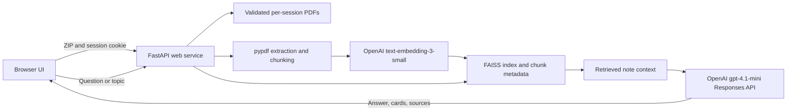

# OT AI Study Engine

OT AI Study Engine is a source-grounded study workspace. A learner uploads a ZIP containing PDF notes, the backend extracts and embeds the text into a per-session FAISS index, and the interface generates cited answers and revision flashcards from the retrieved material.

The application is intentionally a compact FastAPI service with a framework-free frontend. Release 1 focuses on production safety, reliability, accessible user feedback, and test coverage without changing the AI provider or requiring an external authentication vendor. Anonymous session ownership is stored in a local SQLite database.

## Features

- ZIP upload with file-count, compressed-size, expanded-size, PDF-signature, and filename checks.
- PDF text extraction and chunked OpenAI embeddings.
- Atomic PDF replacement and deletion, with the previous document retained until indexing succeeds.
- FAISS similarity search with optional topic/week tags.
- Source-grounded Q&A in detailed or exam mode.
- Six-card structured flashcard generation.
- Page-level source labels for generated material.
- Server-issued anonymous sessions with private, expiring cookies and server-side ownership.
- Clear loading, success, empty, timeout, and failure states.
- Keyboard-accessible, responsive interface with no untrusted HTML injection.
- Health and readiness endpoints for deployment checks.

AI-generated material can be wrong or incomplete. Important answers should always be verified against the cited PDF pages.

## Architecture



The API key is resolved for each AI request. A server-managed `OPENAI_API_KEY` is preferred for deployment; an optional bearer key can be entered for a single browser-tab development session. Browser-entered keys are never persisted by the application.

## Technology stack

Persistence uses one `study.snapshot` per session, containing vectors, chunk metadata, active PDF bytes, and pending PDF bytes. One flushed, atomic file replacement publishes a change. Per-owner thread and OS file locks serialize API mutations across processes on the same local filesystem. Readers see a complete snapshot; an already-running answer may still use the version it loaded before a deletion. Damaged snapshots fail closed. Keep backups of the whole data directory and `sessions.sqlite3` together. This does not provide durable hosting, distributed locking, or power-loss guarantees. See the migration and storage limits below.

| Layer | Technology |
|---|---|
| Web API | Python 3.12, FastAPI, Uvicorn |
| AI | OpenAI Python SDK, Responses API, Embeddings API |
| Retrieval | NumPy and FAISS cosine similarity |
| Documents | pypdf and Python ZIP handling |
| Frontend | Semantic HTML, CSS, and vanilla JavaScript |
| Tests | pytest, FastAPI TestClient, mocked OpenAI SDK responses |
| Hosting | Render web service |

## Repository structure

```text
backend/
  ai_service.py       OpenAI client configuration, prompts, output contracts, error mapping
  backups.py          Portable backup creation, verification, and safe empty-path restore
  core.py             PDF chunking, embeddings, FAISS store, and optional legacy CLI
  server.py           FastAPI routes, validation, upload safety, persistence boundaries
  storage_lock.py     Per-owner Windows/POSIX file locking for API mutations
  requirements.txt    Pinned production dependencies
frontend/
  index.html          Semantic application structure
  styles.css          Responsive visual system
  app.js              API client and safe DOM rendering
tests/                API, upload, AI-mock, and frontend safety tests
docs/
  AUDIT_AND_ROADMAP.md Professional audit and controlled release roadmap
.env.example          Placeholder configuration only
.python-version       Tested Render/Python runtime
requirements.txt      Root production install entry point
requirements-dev.txt  Local test, lint, and audit tools
```

## Local setup

Requirements: Python 3.12 and Git. No API key is needed for the mocked test suite.

### Windows PowerShell

```powershell
py -3.12 -m venv .venv
.\.venv\Scripts\Activate.ps1
python -m pip install -r requirements-dev.txt
Copy-Item .env.example .env
```

### macOS or Linux

```bash
python3.12 -m venv .venv
source .venv/bin/activate
python -m pip install -r requirements-dev.txt
cp .env.example .env
```

For localhost HTTP, set `OT_SESSION_COOKIE_SECURE=false` in your copied `.env`. Production HTTPS must keep it `true`.

Leave `OPENAI_API_KEY=` empty to run the interface and mocked tests without live AI. When a separate development key is available, set it only in the ignored local `.env` file:

```dotenv
OPENAI_API_KEY=
```

Do not commit `.env`, a browser-entered key, or a Render secret.

## Run the application

From the repository root:

```bash
python -m uvicorn backend.server:app --host 127.0.0.1 --port 8000 --reload
```

Open `http://127.0.0.1:8000`. The app shell, upload validation, status endpoint, and missing-key behavior work without an API key. Live ingestion, search, answers, and flashcards require an OpenAI key because both indexing and retrieval create embeddings.

The optional CLI remains available:

```bash
python -m backend.core
```

Local recovery commands are available through `python -m backend.backups`.
Verification and restoration reject more than 10 GiB of expanded archive data
by default; use `--max-uncompressed-bytes` to set a lower deployment-specific
limit. Archive paths that collide after case folding or Unicode normalization
are rejected for cross-platform safety. Backup creation also rejects symlinked
storage paths, study files replaced between inspection and opening, session
databases whose filesystem identity changes while SQLite is copying them, and
session creation or revocation during owner-file collection. Keep backups
encrypted and access-controlled outside the application.

## Environment variables

| Variable | Required | Default | Purpose |
|---|---:|---|---|
| `OPENAI_API_KEY` | For live server-managed AI | none | OpenAI credential; configure as a secret |
| `OPENAI_RESPONSE_MODEL` | No | `gpt-4.1-mini` | Answer and flashcard model |
| `OPENAI_EMBEDDING_MODEL` | No | `text-embedding-3-small` | Index and query embedding model |
| `OPENAI_TIMEOUT_SECONDS` | No | `45` | SDK request timeout |
| `OPENAI_MAX_RETRIES` | No | `1` | SDK retry count for transient failures |
| `CORS_ORIGINS` | No | empty | Non-credentialed public reads only; study sessions are same-origin |
| `OT_DATA_DIR` | No | `backend/users` | Runtime storage root |
| `MAX_UPLOAD_BYTES` | No | `26214400` | Maximum ZIP request size |
| `MAX_UPLOAD_REQUEST_OVERHEAD_BYTES` | No | `65536` | Multipart envelope allowance above the ZIP limit |
| `MAX_ZIP_MEMBERS` | No | `50` | Maximum files in one ZIP |
| `MAX_PDF_BYTES` | No | `12582912` | Maximum expanded size per PDF |
| `MAX_TOTAL_UNCOMPRESSED_BYTES` | No | `52428800` | Maximum expanded PDFs per ZIP |
| `MAX_USER_STORAGE_BYTES` | No | `104857600` | Maximum stored PDFs per session |
| `MAX_DOCUMENTS_PER_SESSION` | No | `50` | Maximum distinct active or pending PDF names per session |
| `MAX_PDF_PAGES` | No | `300` | Maximum pages per ingested PDF |
| `MAX_PDF_TEXT_CHARS` | No | `2000000` | Maximum extracted characters per PDF |
| `MAX_INGEST_CHUNKS` | No | `2500` | Maximum new chunks in one ingestion |
| `MAX_INDEXED_CHUNKS_PER_SESSION` | No | `10000` | Maximum indexed chunks retained per session |
| `MAX_SNAPSHOT_BYTES` | No | `536870912` | Maximum stored size and total expanded members in one study snapshot |
| `MAX_SNAPSHOT_MEMBERS` | No | `1002` | Maximum ZIP members in one study snapshot |
| `MAX_UPLOADS_PER_SESSION_HOUR` | No | `20` | ZIP upload attempts per session per UTC-aligned hour |
| `MAX_UPLOADS_PER_HOUR` | No | `200` | ZIP upload attempts across the service per UTC-aligned hour |
| `MAX_CONCURRENT_AI_REQUESTS_PER_SESSION` | No | `1` | Simultaneous embedding/retrieval/generation operations per session |
| `MAX_CONCURRENT_AI_REQUESTS` | No | `4` | Simultaneous AI operations across the service |
| `AI_CONCURRENCY_LEASE_SECONDS` | No | `3600` | Renewal horizon and crash/accounting-outage recovery window for an AI slot |
| `LOG_LEVEL` | No | `INFO` | Application log level |

Changing the embedding model requires rebuilding every FAISS index because vector dimensions and semantics can differ.

## How the AI integration works

1. **Ingestion:** `POST /ingest_user_pdfs` extracts PDF text into approximately 900-character chunks. Chunks are embedded in batches of 64 with `text-embedding-3-small` and normalized into a FAISS inner-product index.
2. **Retrieval:** Q&A and flashcard requests embed the question/topic and retrieve the closest note chunks, optionally filtered by tag.
3. **Answers:** `gpt-4.1-mini` receives a grounding prompt, untrusted note context, and the learner’s question through the Responses API. Output is plain text plus server-derived source labels.
4. **Flashcards:** the same model receives a strict JSON Schema requiring exactly six question/answer objects. The server validates the decoded structure again before returning it.
5. **Failures:** authentication, permissions, rate limits, timeouts, connection failures, provider errors, and malformed outputs map to stable messages without returning provider payloads.

The SDK is configured for a 45-second timeout and one retry. Output-token limits are 900 for answers and 1,600 for flashcards.

## API endpoints

| Method | Path | Purpose |
|---|---|---|
| `GET` | `/` | Application UI |
| `GET` | `/health` | Lightweight liveness check |
| `GET` | `/ready` | Frontend and storage readiness check |
| `GET` | `/config` | Non-secret public client configuration |
| `POST` | `/session` | Start or resume a server-issued anonymous session |
| `DELETE` | `/session` | Revoke the current session; keep stored files |
| `GET` | `/status` | Index counts, tags, and `document_files` with indexed/pending flags |
| `POST` | `/upload_zip` | Validate and atomically stage a ZIP of PDFs |
| `POST` | `/ingest_user_pdfs` | Atomically index pending PDFs and publish replacements |
| `DELETE` | `/documents/{filename}` | Delete the current session's PDF, pending replacement, and all its chunks |
| `POST` | `/chat` | Generate a grounded answer |
| `POST` | `/flashcards` | Generate six structured flashcards |

All study endpoints require a valid server-issued cookie. `X-User` is rejected; neither a legacy bucket ID nor an OpenAI API key proves ownership. Start a session with `POST /session` and `X-Study-Request: 1`, retain the response cookie, and include that header on every state-changing request. `DELETE /session` revokes access without deleting uploaded files. Cross-origin writes are rejected.

Sessions use random 256-bit tokens, stored only as SHA-256 hashes in `OT_DATA_DIR/sessions.sqlite3`. The database maps each token to a separately generated study bucket. Cookies are HttpOnly, SameSite=Strict, and Secure by default, with the `__Host-` prefix and no Domain attribute. Absolute expiry is 30 days; reloading does not extend it. Private responses use `Cache-Control: no-store`. Session records survive restarts only when the data directory survives.

For **local HTTP development only**, set `OT_SESSION_COOKIE_SECURE=false` in `.env`; this uses a distinct development cookie name. Keep the default `true` on HTTPS deployments. Behind a reverse proxy, configure trusted proxy handling so the application sees the correct public scheme/host; do not weaken origin checks. Serve the study frontend from the API origin. `CORS_ORIGINS` does not enable credentialed cross-origin study access.

**Migration:** old uploads remain on disk but are not claimed using browser-local IDs. Re-upload notes to a new session; any future migration must independently verify ownership. Do not expose an endpoint that adopts a supplied legacy ID. Clearing cookies, expiry, or revocation loses browser access; these are anonymous sessions, not recoverable accounts. Shared-browser users share the cookie. Persist and protect the session database together with the note files.

### PDF replacement, deletion, and storage migration

Upload a ZIP with the same filename, then select **Build index**. Filenames are flattened, sanitized, and case-insensitive (`Week1.pdf` replaces `week1.pdf`). Identity is by filename, not content hash: two differently named PDFs with identical contents remain independently deletable. The library shows pending uploads and replacements. A successful build removes every previous chunk for each replaced filename while retaining other vectors and tags. Re-uploading identical indexed bytes does not embed them again.

ZIP staging and each ingestion batch are all-or-nothing. A corrupt, empty, oversized, or unreadable PDF fails the entire build; embedding or save failures also preserve all active files and searchable notes. Pending uploads survive restart for retry. Upload a corrected file using the same name, or delete the document to remove both active and pending versions. Deletion needs no AI key and persists even when the last document is removed; an absent filename returns 404. A timed-out browser request may still commit: refresh the library before retrying.

For **already authenticated server-issued sessions only**, the first mutation migrates existing `uploads/*.pdf` and index data into the snapshot, then removes the loose PDF and legacy index copies. A manifest marks completed migration before cleanup begins, so interrupted cleanup resumes without importing old files again. PDFs matching their indexed hashes become active; other files remain pending. A filename collision blocks migration. Back up the data directory before upgrading; do not run an older application version against migrated snapshots, because it cannot preserve their embedded documents. Pre-session browser-selected directories are never adopted. Migration cannot recover PDF bytes already overwritten by the old application.

The snapshot is the sole active store; PDFs are ZIP entries inside it, not separate files under `uploads/`. A successful deletion removes the PDF bytes and metadata from that store. Failed/interrupted `snapshot-*.tmp` candidates are ignored on reload and removed under the owner lock at the next mutation. This is application deletion, not secure erasure of disks, backups, or answers already displayed. Backups require their own retention policy.

Active and pending PDF bytes both count toward `MAX_USER_STORAGE_BYTES`, so replacing a document requires room for its rollback copy. The union of active and pending canonical filenames counts toward `MAX_DOCUMENTS_PER_SESSION`; a same-name replacement does not consume another document slot. `MAX_INDEXED_CHUNKS_PER_SESSION` applies after removing the old chunks for every successful replacement. Existing libraries above a newly lowered count cap may make non-growing replacements or deletions, allowing them to be repaired without weakening the cap for new growth. Rejections preserve the active snapshot and staged pending uploads. Deleting a document releases its document and chunk capacity.

Saving rewrites the whole snapshot and temporarily requires space for another complete snapshot, including vectors; reads load the PDF bytes too. `MAX_SNAPSHOT_BYTES` bounds both the stored archive and the sum of declared expanded members before any member is read, while `MAX_SNAPSHOT_MEMBERS` bounds its entry count. Keep these settings above the largest valid library implied by the document, storage, and chunk quotas, and verify any increase against host memory and disk capacity. OS locks protect cooperating API processes on local Windows/POSIX filesystems; network filesystems and multiple hosts are unsupported. The optional legacy CLI does not take these API locks and must not write live session directories. Atomic replacement plus directory flushing protects local snapshot publication, but this is not a simultaneous database/filesystem transaction or a replacement for verified off-host backups.

## Tests and checks

```bash
python -m pytest -q
node --test tests/frontend/*.test.mjs
python -m ruff check backend tests
python -m mypy backend
node --check frontend/app.js
python -m pip_audit -r backend/requirements.txt
python -m compileall -q backend
```

The test suite does not make live OpenAI requests. It mocks successful Responses API output, structured flashcards, embedding batches, malformed output, authentication failure, rate limiting, timeouts, connection failure, and provider unavailability. A deterministic API-level journey also covers session startup, upload, indexing, answers, flashcards, same-name replacement, replacement-aware retrieval, and deletion.

## Render deployment

The current Render dashboard configuration is not stored in this repository, so its live build/start values cannot be proven from Git alone. The repository-compatible values are:

- Runtime: Python 3 (`.python-version` pins `3.12.13`).
- Build command: `pip install -r requirements.txt`.
- Start command: `uvicorn backend.server:app --host 0.0.0.0 --port $PORT`.
- Health check path: `/health`.
- Required secret for live AI: `OPENAI_API_KEY`.
- Root directory: repository root.

No frontend build step, database migration, or static-site service is required. FastAPI serves the frontend itself.

Before changing the live service, compare these values with **Render Dashboard → Settings**, use a preview service or manual branch deploy, verify `/health`, `/ready`, upload, mocked failure states, and a restricted development-key integration test, then promote only after approval.

### Storage on Render

Render’s default web-service filesystem is ephemeral. Session snapshots under `backend/users` can disappear on a restart or deployment and are not safe durable storage. Data remains local to one filesystem, so horizontal scaling is unsupported.

A later persistence release can use either:

- a paid Render persistent disk with `OT_DATA_DIR` set to its mount path; or
- object storage plus a database/vector store after cost, privacy, deletion, and migration design is approved.

Do not add a disk or database to the live service without a migration and retention plan.

### Backup and recovery

The repository includes a provider-neutral backup command for the complete
`OT_DATA_DIR`. The archive contains PDF contents and hashed session credentials,
so store it encrypted with access controls and a retention/deletion policy. The
creator takes each owner's storage lock, uses SQLite's backup API, writes a
SHA-256 manifest, flushes and verifies the completed archive before exclusive
publication, and flushes publication metadata on supported POSIX filesystems.
Backup files and restore directories use the platform's native atomic
no-replace rename on Linux, macOS, and Windows, so publication does not require
hard-link support and cannot overwrite a concurrently created destination.
Backup and restore staging paths are owner-private and securely randomized, so
stale process-ID paths cannot block later recovery operations.

```bash
python -m backend.backups create --data-dir backend/users --output /secure/ot-ai-backup.otai
python -m backend.backups verify --backup /secure/ot-ai-backup.otai
python -m backend.backups restore --backup /secure/ot-ai-backup.otai --destination /restore-test/users
```

Restore deliberately accepts only a destination that does not exist; it never
merges with or overwrites live data. Verification and extraction happen in one
streaming pass from the same descriptor-pinned regular archive; symlinked or
replaced archive paths are rejected. The complete manifest and exact archive
member set are validated before any recovery file is staged. Versioned manifest
fields, timestamps, and file-entry types are accepted strictly rather than
silently ignoring unknown metadata. Case-insensitive path collisions are
rejected for Windows portability. Verified restore files and directories
are flushed before atomic publication on POSIX; Windows flushes regular files
but does not provide directory flushing through this tool. A final metadata
flush failure reports an error without deleting an already-published complete
output. On POSIX systems, created archives and
restored files use mode `0600`, while restored data roots use `0700`; retain
equivalent owner-only access controls on other platforms. Test restoration to a
separate path, start the application with `OT_DATA_DIR` pointing there, and
verify the study flow before scheduling backups. The tool validates checksums,
the session database schema and record formats, every session owner's presence
in the archive, and every FAISS/metadata snapshot. Copy the verified archive
off-host: a backup on the same ephemeral filesystem does not protect against a
Render restart.

## Security and privacy

- Uploaded documents are treated as untrusted content and cannot override the system prompt.
- Archive and PDF limits reduce ZIP-bomb and memory-exhaustion risk.
- User IDs are constrained to safe opaque identifiers and checked against the storage root.
- AI/provider error bodies are not returned to users.
- API keys are never rendered by `/config`, logged, or saved by the frontend.
- Untrusted sources, answers, and flashcards are inserted with `textContent`, not HTML.
- Same-origin requests are the default; cross-origin access is opt-in.
- Security headers deny framing, external scripts, and unnecessary browser permissions.

Important limitation: cookie-based anonymous ownership is enforced, but there are no user accounts, recovery, or cross-device identity. Anyone with the session cookie can act as that session. Public-launch blockers still include abuse controls, durable hosting, and tested backup recovery.

The public Git history previously included uploaded study documents even though they were later deleted from the current branch. See [the audit](docs/AUDIT_AND_ROADMAP.md) for the required history-cleanup procedure. Do not add new user data to Git.

## Troubleshooting

### `ModuleNotFoundError: core`

Run the package-safe command from the repository root:

```bash
python -m uvicorn backend.server:app --host 127.0.0.1 --port 8000
```

### “AI service is not configured”

This is expected when `OPENAI_API_KEY` is empty and no temporary browser-session key is supplied. The UI and mocked tests still work.

### Upload accepted but no text is indexed

The PDF may be image-only, encrypted, malformed, or beyond a safety limit. OCR is not implemented. The failed build names the unreadable PDF and preserves the previous library. Upload a corrected version or delete it before rebuilding.

### Notes disappear on Render

This is expected on an ephemeral filesystem after service restart or deployment. Persistence requires a separately approved disk or datastore plan.

### Existing index will not load

Restore a verified backup of the complete session snapshot. Corrupt snapshots and partial legacy index pairs fail closed; uploading again does not bypass the error. Do not remove the snapshot to force a legacy fallback. Index dimensions must match the configured embedding model.

## Known limitations

- No user accounts, password reset, session recovery, or secure cross-device identity.
- Runtime files are ephemeral on a default Render web service.
- No OCR for scanned/image-only PDFs.
- No durable job queue; large ingestion requests occupy one worker.
- Whole-snapshot storage increases memory and write costs; distributed/multi-host storage is unsupported.
- No citation spans or highlighted source passages yet.
- No live OpenAI integration test is run in CI.
- Retrieval quality has no labelled evaluation dataset yet.

## Roadmap

1. Production safety and stability — implemented on `codex/ot-ai-next-level`; history purge remains an owner-approved operation.
2. UX and visual polish — responsive study workspace, export options, and stronger progress feedback.
3. AI study quality — retrieval evaluation, source excerpts, difficulty controls, and carefully selected quiz modes.
4. Accounts and persistence — only after an approved privacy, cost, retention, and migration design.
5. Portfolio readiness — screenshots, demo-safe sample material, automated CI, release tags, and product metrics.

See [Audit and roadmap](docs/AUDIT_AND_ROADMAP.md) for priorities and deployment risk.
## Request and concurrency budgets (20 September 2026)

Before exposing the app publicly, review these positive integer settings:

| Setting | Default | Scope |
| --- | --- | --- |
| `MAX_NEW_SESSIONS_PER_HOUR` | 100 | New anonymous sessions across the service |
| `MAX_AI_REQUESTS_PER_SESSION_HOUR` | 60 | Ingest, chat and flashcards combined per owner |
| `MAX_AI_REQUESTS_PER_DAY` | 500 | Those AI route attempts combined across all owners |
| `MAX_UPLOADS_PER_SESSION_HOUR` | 20 | ZIP upload attempts per owner |
| `MAX_UPLOADS_PER_HOUR` | 200 | ZIP upload attempts across all owners |
| `MAX_CONCURRENT_AI_REQUESTS_PER_SESSION` | 1 | In-flight AI work per owner |
| `MAX_CONCURRENT_AI_REQUESTS` | 4 | In-flight AI work across all owners |

Budgets use UTC-aligned fixed windows, atomically reserved in `usage_limits` in
the existing `sessions.sqlite3`. Workers sharing the same local data directory
share counters, including after restart. Preserve this database in backups.
Schema creation is additive; no existing sessions or documents are removed.
Returning sessions do not consume the new-session budget. New cookies and
client-supplied forwarding headers cannot reset the service-wide budgets.
BYOK requests are also limited. All applicable budgets reserve together before
loading notes, parsing PDFs or making AI calls; failed/empty attempts still count
and are not refunded. Authentication, CSRF, tags and API-key availability are
checked first. A failed session mint also retains its reservation.

Upload attempts reserve both hourly budgets before the application reads or
decompresses the uploaded file; invalid or failed attempts are not refunded.
This is application-level protection and does not prevent a reverse proxy from
receiving a request body. Configure body-size and request-rate enforcement at a
trusted edge as well.

Embedding, retrieval and generation hold atomic per-owner and global SQLite
leases. Workers sharing one local data directory therefore enforce the same
limits. A heartbeat renews healthy leases every third of
`AI_CONCURRENCY_LEASE_SECONDS`; normal completion and provider failures release
them immediately. If a worker dies, renewal stops and the slot recovers after
the configured window. Set that window long enough to tolerate a temporary
SQLite/storage outage: if every renewal fails for the entire window, another
request can eventually reclaim the slot. Status, document deletion and session
revocation neither acquire nor wait for an AI lease.

Exhaustion returns HTTP 429 with `Retry-After` seconds and a user-readable retry
message. Accounting storage errors fail closed with HTTP 503. Status, document
deletion and session revocation remain available when AI budgets are exhausted.

These are **request caps, not a monetary spending guarantee**: one ingest can
perform multiple embedding calls, and SDK retries can make additional calls.
Use provider-side project budgets/alerts as well. A fixed window permits a burst
on each side of its boundary. There is no per-IP fairness, token accounting,
multi-host coordination, or edge/network flood protection.
One attacker can exhaust a shared budget and deny service to other visitors;
use a trusted edge limiter before broader public access. Do not trust arbitrary
forwarded IP headers. Existing ZIP/PDF/storage byte and cumulative document/chunk
limits remain in effect.
Separate or ephemeral data directories reset/separate quotas, so these limits
must not be presented as distributed or durable hosting protection.
